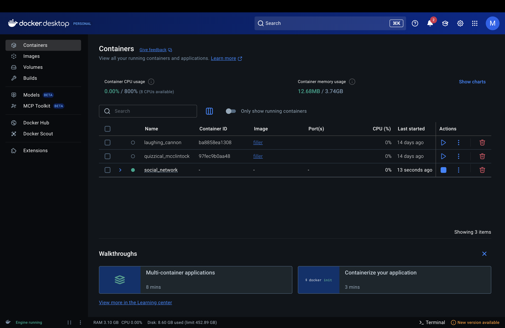
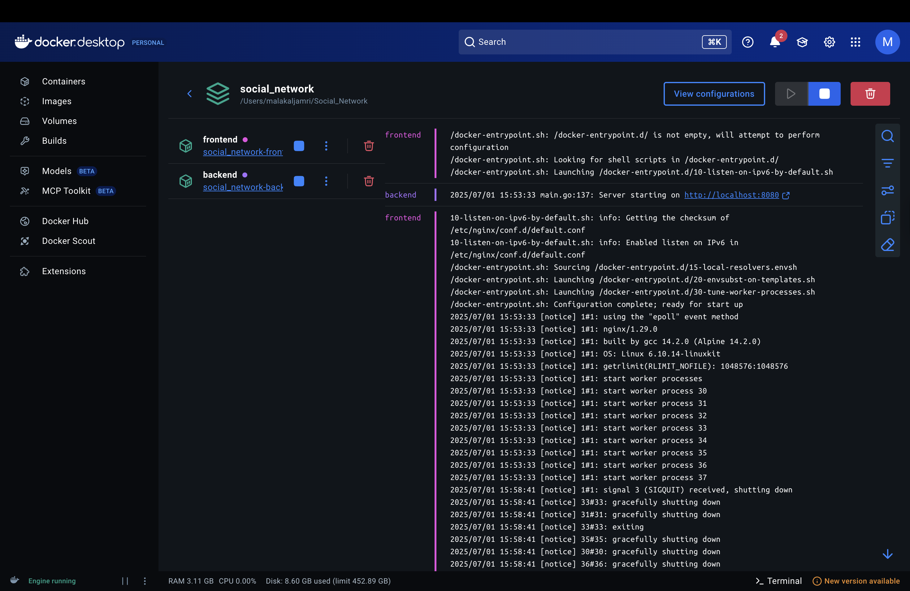

# 1- caddy is done i think 
By running the command:
caddy file-server --root ~/Social_Network/web --listen :8080

We installed and ran Caddy to serve your website’s static files from your project folder on localhost:8080. 
we confirmed the site loads correctly, ensuring your web server setup works.

-------------

# Modify the User struct to align with the registration requirements.
# Update the following files:
db_users.go
auth.go
M_register.js

# In each, implement validation for the required fields at the section marked:
// Validate required fields
Keep using nickname as the username.
In the database schema, modify the username column to:
username TEXT UNIQUE
(Remove the NOT NULL constraint.)
Keep the following INSERT query as-is:

query := `INSERT INTO users (email, password, birthDate, first_name, last_name, avatar, nickname, about_me) VALUES (?, ?, ?, ?, ?, ?, ?, ?)`

-----------

# ignore the Docker for now i will make sure it will work if we finish inshallah 

-------------

# Docker now is done 

to run it use " docker-compose up "

